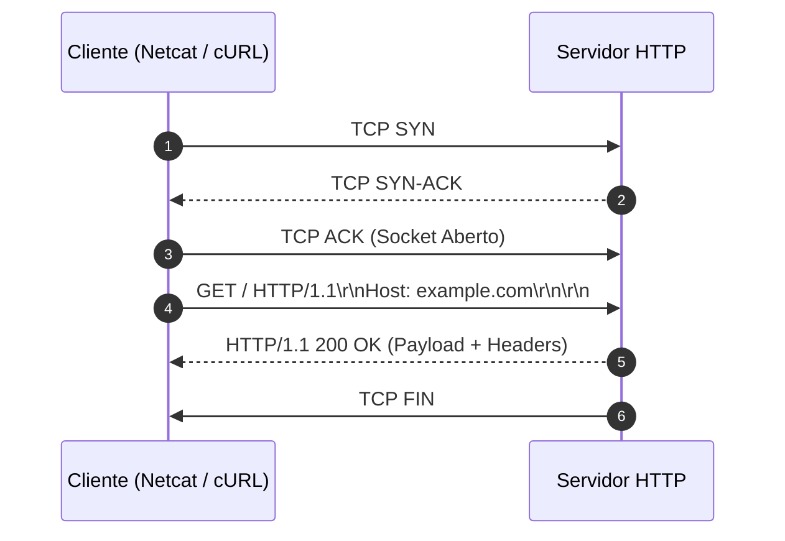

# Memória de Desenvolvimento — Semana 01: Protocolo HTTP & Sockets Bare-Metal
**Aluno:** Gabriel de Silva Gomes  
**Matrícula:** 202421200056  
**Curso:** Sistemas da Informação  

---

## 1. Mapeamento da Camada de Transporte
Diagrama Mermaid demonstrando o ciclo de vida da requisição executada no laboratório:

---

## 2. Registro dos Experimentos de Laboratório

### Experimento 1: Netcat Nu & Falha 400 Bad Request
* **Comando Testado:** `nc -C example.com 80` sem o header `Host:`
* **Resultado:** 
PS C:\WINDOWS\system32> ncat -C example.com 80
GET / HTTP/1.1
User-Agent: TerminalCC/1.0
Connection: close

HTTP/1.1 400 Bad Request
Server: cloudflare
Date: Mon, 26 Oct 2026 02:31:40 GMT
Content-Type: text/html
Content-Length: 155
Connection: close
CF-RAY: -

<html>
<head><title>400 Bad Request</title></head>
<body>

<h1>400 Bad Request</h1>

cloudflare

</body>
</html>

### Experimento 2: Semântica dos Métodos HTTP
* **Análise dos Verbos:** Explique a diferença observada entre chamadas `GET`, `POST` e `OPTIONS`.
* **Header Content-Length:** Como o tamanho do payload afeta a leitura no buffer do socket?
* Analise dos verbos: Em get, não se é utilizado argumentos, em post, se utiliza os argumentos -x e -v, e em options, se utiliza os argumentos -i -x
* O tamanho do payload afeta a leitura no buffer aumentando o content-lenth

### Experimento 3: URL, Query Strings & Percent-Encoding
* **URL Testada: (Passo 1)** curl -v http://httpbin.org/get?curso=Engenharia da Computacao
* **URL Testada: (Passo 2)** curl -v https://httpbin.org/get?curso=Engenharia%20da%20Computa%C3%A7%C3%A3o
* **O erro no Passo 1:** O que o terminal retornou ao tentar rodar a URL com espaços reais?
Invoke-WebRequest : Não é possível localizar um parâmetro posicional que aceite o argumento 'da'.
No linha:1 caractere:1
+ curl -v http://httpbin.org/get?curso=Engenharia da Computacao
+ ~~~~~~~~~~~~~~~~~~~~~~~~~~~~~~~~~~~~~~~~~~~~~~~~~~~~~~~~~~~~~
    + CategoryInfo          : InvalidArgument: (:) [Invoke-WebRequest], ParameterBindingException
    + FullyQualifiedErrorId : PositionalParameterNotFound,Microsoft.PowerShell.Commands.InvokeWebRequestCommand
  
* **A função do `%20`:** Explique de forma simples por que somos obrigados a substituir espaços e caracteres especiais (como acentos) por códigos com `%` nas URLs.
A arquitetura da internet (definida pela RFC 3986) determina que uma URL só pode conter um grupo muito restrito de caracteres (letras do alfabeto inglês, números e alguns símbolos como ?, &, =), e para resolver isso, criou-se o Percent-Encoding: o espaço vira %20, a letra ç vira %C3%A7, e a letra ã vira %C3%A3. Dessa forma, a URL se torna uma sequência contínua de texto perfeitamente válida e segura, permitindo que o servidor processe o texto completo ("Engenharia da Computação") sem ambiguidades. 

### Experimento 4: Negociação de Conteúdo & User-Agent
* **Análise:** Como o servidor reage ao receber diferentes cabeçalhos `Accept` e `User-Agent`?
o Accept indica o formato dos dados que o cliente quer receber, enquanto o User-Agent identifica quem está fazendo a requisição.
Accept:
O cabeçalho Accept avisa ao servidor qual formato de arquivo (MIME type) o seu programa consegue entender (ex: JSON, HTML, XML, imagem). Se o cliente envia Accept: application/json e o servidor possui os dados nesse formato, ele processará a requisição e devolverá o conteúdo formatado como JSON, acompanhado do cabeçalho Content-Type: application/json na resposta.
Se nos arquivos que você enviou, o cabeçalho está como Accept: */*, isso diz ao servidor: "Aceito qualquer formato que você tiver disponível", e nesse caso, o servidor escolhe o formato padrão dele.
Se for exigido um formato específico que o servidor não sabe ou não quer gerar (ex: enviar Accept: text/csv para uma API que só gera JSON), o servidor pode rejeitar a requisição e retornar o erro 406 Not Acceptable.
User-Agent:
É utilizado para identificar o navegador, ferramenta ou script que está disparando a requisição. O servidor lê essa string para entender o contexto do cliente, podendo ser usado para responder apropriadamente com formatos especificos de resposta ou para negar automaticamente requisições de tipos de clientes predeterminados.

### Experimento 5: Redirecionamentos & Cache Condicional
* **Redirecionamento (301):** Qual a diferença ao executar `curl -I` com e sem a flag `-L`?
* Sem a flag -L:
O curl vai te mostrar apenas o cabeçalho desse redirecionamento (o código 301 ou 302) e a linha Location: <nova_url>, que indica para onde o usuário deveria ser enviado. Ele não segue para o endereço final, morrendo na primeira resposta que encontrar.
* Com a flag -L:
A flag -L (ou --location) dá uma ordem explícita ao curl, se a primeira resposta for um redirecionamento (3xx), o curl automaticamente fará uma nova requisição para a nova URL indicada no campo Location. Ele repetirá esse processo quantas vezes forem necessárias até chegar na página final (onde receberá um código 200 OK de sucesso ou algum erro como 404 Not Found). Ele vai imprimir na tela os cabeçalhos de todas as etapas do caminho (o cabeçalho do redirecionamento e, logo abaixo, o cabeçalho do destino final).

* **Validação de Cache (304):** Explique como o header `If-None-Match` e a `ETag` evitam retransmissão de dados na rede.
A ETag serve como um código hash calculado usado para identificar uma versão especifica de um arquivo. Ao reacessar uma pagina, ele envia 
o Etag do acesso anterior dentro de um if-none-match, para verificar se o arquivo ainda é o mesmo, evitando o reenvio de arquivos repetidos.
---

## 3. Conclusão Técnica
Compreender a transmissão de bytes ASCII e a sintaxe CRLF (\r\n) é fundamental para garantir a interoperabilidade e a segurança em sistemas distribuídos, pois padroniza a comunicação universal entre servidores e evita falhas críticas de interpretação de dados. Além disso, em cenários de alta performance, o domínio dessa estrutura de baixo nível permite que os desenvolvedores criem rotinas de leitura de memória extremamente eficientes, minimizando o consumo de CPU e preparando a infraestrutura para a adoção de protocolos binários modernos e mais velozes.
