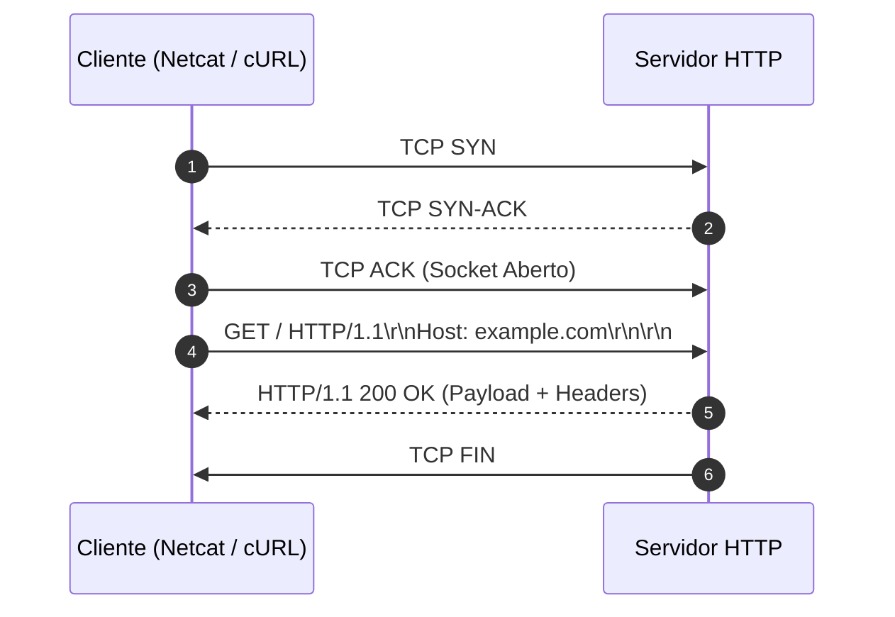

# Memória de Desenvolvimento — Semana 01: Protocolo HTTP & Sockets Bare-Metal
**Aluno:** Gabriel de Silva Gomes  
**Matrícula:** 202421200056  
**Curso:** Sistemas da Informação  

---

## 1. Mapeamento da Camada de Transporte
Diagrama Mermaid demonstrando o ciclo de vida da requisição executada no laboratório:

---

## 2. Registro dos Experimentos de Laboratório

### Experimento 1: Netcat Nu & Falha 400 Bad Request
* **Comando Testado:** `nc -C example.com 80` sem o header `Host:`
* **Resultado:** 
PS C:\WINDOWS\system32> ncat -C example.com 80
GET / HTTP/1.1
User-Agent: TerminalCC/1.0
Connection: close

HTTP/1.1 400 Bad Request
Server: cloudflare
Date: Mon, 26 Oct 2026 02:31:40 GMT
Content-Type: text/html
Content-Length: 155
Connection: close
CF-RAY: -

<html>
<head><title>400 Bad Request</title></head>
<body>

<h1>400 Bad Request</h1>

cloudflare

</body>
</html>

### Experimento 2: Semântica dos Métodos HTTP
* **Análise dos Verbos:** Explique a diferença observada entre chamadas `GET`, `POST` e `OPTIONS`.
* **Header Content-Length:** Como o tamanho do payload afeta a leitura no buffer do socket?
* Analise dos verbos: Em get, não se é utilizado argumentos, em post, se utiliza os argumentos -x e -v, e em options, se utiliza os argumentos -i -x
* O tamanho do payload afeta a leitura no buffer aumentando o content-lenth

### Experimento 3: URL, Query Strings & Percent-Encoding
* **URL Testada: (Passo 1)** curl -v http://httpbin.org/get?curso=Engenharia da Computacao
* **URL Testada: (Passo 2)** curl -v https://httpbin.org/get?curso=Engenharia%20da%20Computa%C3%A7%C3%A3o
* **O erro no Passo 1:** O que o terminal retornou ao tentar rodar a URL com espaços reais?
* **A função do `%20`:** Explique de forma simples por que somos obrigados a substituir espaços e caracteres especiais (como acentos) por códigos com `%` nas URLs.

### Experimento 4: Negociação de Conteúdo & User-Agent
* **Análise:** Como o servidor reage ao receber diferentes cabeçalhos `Accept` e `User-Agent`?

### Experimento 5: Redirecionamentos & Cache Condicional
* **Redirecionamento (301):** Qual a diferença ao executar `curl -I` com e sem a flag `-L`?
* **Validação de Cache (304):** Explique como o header `If-None-Match` e a `ETag` evitam retransmissão de dados na rede.

---

## 3. Conclusão Técnica
[Descreva em 1-2 parágrafos a importância de compreender a transmissão de bytes ASCII e a sintaxe CRLF na camada de aplicação para desenvolvimento de sistemas distribuídos e de alta performance.]
